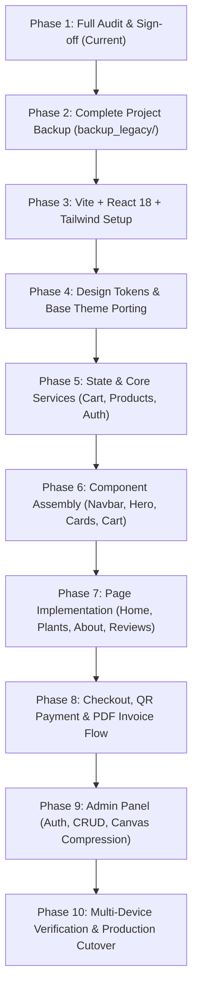

# AMOURA CRAFTS — COMPREHENSIVE PROJECT AUDIT & REACT MIGRATION BLUEPRINT

**Generated:** November 19, 2026  
**Auditor:** Senior Full-Stack Architect  
**Project:** Amoura Crafts (Luxury Handcrafted Soy Candles, Custom Resin Art & Botanical Decor)  
**Live Production URL:** [amouracrafts.com](https://amouracrafts.com)  
**Git Repository:** [github.com/anjali22-05/amouracrafts](https://github.com/anjali22-05/amouracrafts.git) (`main` branch)  
**Hosting Environment:** Netlify Edge + Serverless Functions  
**Cloud Database:** Google Spreadsheets (App Script Webhook) + Netlify Blobs + Client IndexedDB  

---

## 1. EXECUTIVE SUMMARY

Amoura Crafts is a fully functioning, production-ready e-commerce platform specializing in luxury organic soy candles, custom resin art plaques/clocks, and live botanical decor. The website currently operates on a high-performance vanilla multi-page architecture (HTML5, CSS3, vanilla ES6+ JavaScript, Netlify Serverless Functions, and Google Sheets database).

The objective is to migrate this working platform to a modern, scalable **React.js + Tailwind CSS + Vite** Single Page Application (SPA), while preserving:
1. **100% of existing visual design, animations, and luxury dark/gold aesthetic.**
2. **Every active product, category, description, price, MRP, and high-resolution image asset.**
3. **The complete shopping cart, free shipping math, custom color picker, and WhatsApp order dispatch.**
4. **The online QR payment flow (`images/payment.jpeg`) and in-browser PDF invoice generation.**
5. **The complete Admin Panel with PBKDF2 hashed password authentication, canvas image auto-compression, and real-time Add/Edit/Delete synchronization.**
6. **All existing Python backend, batch processing, and automation scripts.**
7. **Zero downtime or breakage of the live website during development.**

---

## 2. CODEBASE INVENTORY & ARCHITECTURAL AUDIT

### 2.1 File Catalog

| Category | File Path | Size / Lines | Core Function & Responsibility |
|---|---|---|---|
| **Core Webpages** | `index.html` | 217 KB / 5,798 lines | Main storefront: Hero, Value Props, Candles Catalog (33 items), Resin Art Catalog (5 items), 3D Showcase, Bulk Gifting, Cart Drawer, Checkout Modal, Order Confirmation, Payment QR Modal, PDF Invoicing. |
| | `plants.html` | 125 KB / 3,500 lines | Botanical decor storefront: Live potted plants, succulent arrangements, botanical resin art, specialized plants cart & order flow. |
| | `about.html` | 81 KB / 1,810 lines | Brand heritage page: Founder Ms. Anupam Saxena & co-founder Ms. Sangeeta Gupta story, artisan workshop philosophy, quality standards. |
| | `reviews.html` | 38 KB / 860 lines | Dedicated customer testimonials page: Live review cards, star rating filters (1–5 Stars), sorting (Newest/Highest), review submission form. |
| | `admin.html` | 69 KB / 1,780 lines | Secure Admin Portal: PBKDF2 password authentication, Change Password modal, Add Product form with canvas compression, Edit Product modal, Delete product flow, mobile cards layout. |
| **Stylesheets** | `header-responsive.css`| 8 KB / 240 lines | Mobile navigation drawer, hamburger button, touch animations, sticky header states. |
| | `global-compact.css` | 28 KB / 850 lines | Shared CSS typography, luxury reset, design tokens, responsive breakpoints. |
| | In-page `<style>` | ~3,000 lines (inline) | Dark & gold luxury styling, glow effects, glassmorphic cards, gold foil gradients. |
| **Client JS Engines** | `products-engine.js` | 20 KB / 460 lines | `ProductManager` singleton: 0ms offline display via IndexedDB (`amoura_products_db`) and LocalStorage (`amoura_custom_products_v1`), real-time cloud sync with Netlify API & Google Sheets, deleted product registry (`amoura_deleted_product_ids_v1`), cross-tab storage broadcaster. |
| | `reviews-engine.js` | 10 KB / 270 lines | `ReviewsEngine`: Fetches approved reviews from Google Sheets API, filters out demo/seed records, calculates average ratings, submits new reviews. |
| | External CDN Libraries | CDN Scripts | jsPDF v2.5.1 (client-side PDF generation), Google Fonts (Playfair Display, Plus Jakarta Sans). |
| **Serverless Functions** | `netlify/functions/admin-auth.js` | 7.8 KB / 267 lines | Server-side PBKDF2 password verification (SHA-512, 10,000 iterations), HMAC-SHA256 signed JWT tokens (7-day validity), timing-safe equal verification. |
| | `netlify/functions/products.js` | 11.5 KB / 290 lines | Serverless REST API for products (GET, POST, PUT, DELETE), in-memory fallback, Netlify Blobs support, Google Sheets webhook forwarder. |
| | `netlify/functions/reviews.js` | 4.3 KB / 140 lines | Serverless endpoint proxying Google Sheets reviews and filtering legitimate submissions. |
| **Cloud Database** | `google-apps-script-all-in-one.js` | 8.9 KB / 218 lines | Google Apps Script Web App connecting Google Spreadsheet: Sheet 1 ("Reviews"), Sheet 2 ("Products"), Sheet 3 ("AdminAuth"). |
| **Configuration** | `_headers` | 12 lines | HTTP security headers (`SAMEORIGIN`, `nosniff`, `max-age=31536000` for images). |
| | `robots.txt` | 6 lines | Search engine crawler rules (disallows `/admin.html` and `/.netlify/`). |
| | `sitemap.xml` | 62 lines | XML sitemap covering canonical URLs, image metadata, and change frequencies. |
| | `package.json` | 10 lines | Node.js manifest with `@netlify/blobs` dependency. |
| **Automation Scripts** | 30+ Python scripts (`*.py`) | ~35 KB combined | Historical DOM processors, asset organizers, image compressors, batch data sync scripts. |

---

## 3. ASSET & MEDIA INVENTORY

```
images/
├── 147 root image files (JPG, PNG, WEBP)
│   ├── payment.jpeg (400x368 RGB JPEG, 56,288 bytes) ──> ACTIVE PAYMENT QR CODE
│   ├── logo.png (Brand emblem)
│   ├── Lotus Flower Decoration Candle.webp
│   ├── img_1.jpg through img_31.jpg (Candle collection)
│   ├── resin_1.jpg through resin_5.png (Resin Art collection)
│   └── plant_1.jpg through plant_4.jpg (Botanical collection)
├── 3d/ (16 files)
│   └── gallery_3d_1.jpg/webp through gallery_3d_8.jpg/webp (Interactive showcase)
└── thumbs/ (147 files)
    └── Optimized WebP and JPG thumbnails corresponding to all root images
```

> [!IMPORTANT]
> - All image paths are structured with `images/<filename>` and `images/thumbs/<basename>.webp`.
> - In React, these must reside in `/public/images/` so that existing image URLs (`images/payment.jpeg`, `images/logo.png`, `images/img_1.jpg`) resolve without path rewriting.
> - `payment.jpeg` is strictly preserved at original 400x368 resolution.

---

## 4. DETAILED FEATURE-BY-FEATURE ARCHITECTURE AUDIT

### 4.1 Product Catalog Architecture
- **Candles Catalog (`index.html`):**
  - 33 hardcoded artisan items starting with `lotus-flower-decoration-candle` (₹400, MRP ₹549), `vintage-ivory-bloom` (₹399), `aurelia-bloom-royal-golden-candle` (₹320), up to `velvet-heart-luxe-candle` (₹650).
  - Merged at runtime with custom products from `ProductManager.getProducts()`.
- **Resin Art Catalog (`index.html`):**
  - 5 hardcoded items: `resin-1` (Ganesha Resin Art Tray, ₹899), `resin-2` (Resin Name Tags, ₹249), `resin-3` (Brother Resin Tags, ₹449), `resin-4` (Teal Geode Clock, ₹2499), `resin-5` (Pink Ganesha Plaque, ₹699).
- **Plants Catalog (`plants.html`):**
  - 4 hardcoded items: `plant-1` (Pressed Flower Earrings, ₹349), `plant-2` (Syngonium Plant, ₹499), `plant-3` (Jade Bonsai, ₹599), `plant-4` (Succulent Bowl, ₹799).
- **Product Card UI:**
  - Image with fallback onError handler.
  - Tag badge (`Bestseller`, `New Arrival`, `Festive Special`, `Royal Edition`, `Artisan Pick`).
  - Selling price in bold gold + original MRP with strikethrough.
  - Quantity selector (`- 1 +`).
  - "Add to cart" and "Buy now" buttons.

### 4.2 Shopping Cart & Checkout System
- **State Storage:** `cart` array stored in memory and synced with `localStorage`.
- **Free Shipping Engine:**
  - Threshold: **₹1,000**.
  - If Subtotal $\ge ₹1,000$ ➔ Shipping is **FREE (₹0)**.
  - If Subtotal $< ₹1,000$ ➔ Flat Shipping is **₹99**.
  - Dynamic progress indicator in cart drawer showing amount remaining to unlock free delivery.
- **Checkout Fields:**
  - Full Name, Mobile Phone (10 digits), Email Address, Street Address, City, State, Pincode (6 digits).
  - **Preferred Color (Optional):** Dropdown + free text (`Sky Blue`, `Dark Red`, `Lavender`, `Custom Pink`, `White`, `Gold`, `Default`).
  - Special Delivery Instructions / Notes.
- **WhatsApp Order Integration:**
  - Customer WhatsApp Number: `918700689036` (configured in `SITE_CONFIG`).
  - Encoded WhatsApp URL contains Order ID, Invoice Number, full item list with quantity and line totals, Subtotal, Shipping, Final Total, Delivery Address, and Customer Color choice.
  - Secondary automated alert generated for Admin notification.

### 4.3 Payment & Invoice System
- **Payment Gateway Modal (`#paymentModal`):**
  - Displays clean white container with `images/payment.jpeg` QR code.
  - Centered with `object-fit: contain` and max-width 280px.
  - Shows dynamic order amount formatted as `₹<amount>`.
  - UPI ID text and copy button were removed as requested.
  - "I've Completed Payment" triggers confirmation and opens invoice modal.
- **Client-Side PDF Generator (jsPDF):**
  - Generates branded luxury invoice with Amoura Crafts header, invoice number, customer billing details, line items table, and total calculations.
  - Downloads as `Amoura-Crafts-Invoice-<InvoiceNo>.pdf` without server overhead.

### 4.4 Admin Panel & Authentication
- **Authentication Flow:**
  - PBKDF2 password hashing (10,000 iterations, SHA-512) stored in `netlify/functions/admin-auth.js` and synced to Google Sheets ("AdminAuth").
  - Frontend never receives plaintext password.
  - HMAC-SHA256 signed session token stored in `sessionStorage` and `localStorage` (`amoura_admin_token`).
  - Password Change modal allows admin to update master credentials securely.
- **Product Management:**
  - **Add Product:** Real-time client-side HTML5 Canvas compression (max 800x800px, 80% JPEG quality) to prevent payload overage; fields for Name, Price, MRP, Category (`candles`, `resin`, `plants`), Tag, Description.
  - **Edit Product:** In-place modal editing. Keeps existing image if no new file is chosen.
  - **Delete Product:** Multi-tier permanent delete removing item from IndexedDB, LocalStorage, Netlify function, Google Sheets, and adding ID/name to persistent `DELETED_KEY` blacklist so cloud sync never resurrects deleted items.
  - **Responsive View:**
    - Desktop ($\ge 769\text{px}$): Complete data table with image, category pill, price, MRP, date, and actions.
    - Mobile ($\le 768\text{px}$): Full-width cards with large touch-friendly buttons (👁️ View, ✏️ Edit, 🗑️ Delete).

### 4.5 Python Scripts Analysis
The 30+ Python scripts in the root directory fall into distinct categories:
1. **DOM & Content Batch Processors:** `add_resin.py`, `update_all.py`, `fix_footer.py`, `fix_brand_text.py`, `fix_whatsapp.py`, `update_email.py`, etc. (used during development to batch-update footers, color options, WhatsApp numbers).
2. **Image Optimization & Generation:** `fix_images.py`, `make_transparent.py`, `rename_images.py`, `copy_qr.py`, `finalize_logo.py` (interfaced with Pillow/PIL for batch resizing and format conversions).
3. **Template Cloners:** `make_plants_page.py`, `update_plants.py` (cloned `index.html` structure into `plants.html`).

*Conclusion on Python:* None of these scripts run as active persistent HTTP web servers on Netlify (Netlify runs Node.js serverless functions). However, they represent valuable offline maintenance tools. They will be organized neatly into a `scripts/` directory and preserved with complete documentation.

---

## 5. POTENTIAL RISKS & MIGRATION CHALLENGES

| # | Risk Area | Technical Root Cause | Prevention & Architectural Solution |
|---|---|---|---|
| **1** | **Asset / Image Path Breakage** | Relative paths (`images/img_1.jpg`) failing under React router nested paths (`/admin/edit`). | Place images in `/public/images/` and use absolute root-relative URLs (`/images/...`). |
| **2** | **Admin Data Desynchronization** | React re-render loops or stale state conflicting with IndexedDB / LocalStorage. | Encapsulate `ProductManager` in a robust custom hook (`useProducts`) with subscription to `amoura_products_changed` custom events. |
| **3** | **jsPDF Bundle Bloat & Compatibility** | jsPDF dynamic canvas rendering failing in Vite ESM bundler. | Import `jspdf` via modern ES module syntax; port coordinates and styling from `index.html` line-for-line. |
| **4** | **WhatsApp Encoding Corruption** | Special characters (₹, newlines, emojis) breaking on mobile browsers. | Use standard `encodeURIComponent()` wrapper in a dedicated `src/utils/whatsapp.js` module. |
| **5** | **Live Website Disruption** | Overwriting existing HTML files before the React app is verified. | Build Vite project in a modern directory structure while keeping legacy files completely intact until final production sign-off. |
| **6** | **Tailwind Style Discrepancies** | Missing custom gold/dark color values or font classes. | Configure custom Tailwind theme tokens matching existing CSS variables (`--bg-primary`, `--gold`, `--cream`, `--wine`, etc.). |

---

## 6. PHASED MIGRATION PLAN (STEP-BY-STEP)



### Detailed Phase Milestones:

- **Phase 1: Audit Approval (THIS TURN)**  
  Deliver this comprehensive audit and await user confirmation.
- **Phase 2: Complete Project Backup**  
  Clone all existing files into a protected `backup_legacy/` folder so the current site can be restored at any moment.
- **Phase 3: Vite + React + Tailwind Initialization**  
  Initialize Vite configuration with Tailwind CSS without modifying existing legacy HTML/JS.
- **Phase 4: Design System Configuration**  
  Configure `tailwind.config.js` with exact Amoura Crafts brand colors (`gold`, `cream`, `dark`, `borderGold`), import Google Fonts (`Playfair Display`, `Plus Jakarta Sans`), and set up base CSS utilities.
- **Phase 5: Core Services & Data Porting**  
  Port `candles.js`, `resin.js`, `plants.js` static data. Port `ProductManager` into `productService.js` and `CartContext.jsx`. Port `authService.js` and `whatsapp.js`.
- **Phase 6: Common Components & Layout**  
  Build `Navbar`, `Footer`, `Hero`, `ProductCard`, `ProductGrid`, `CartDrawer`, and `Toast`.
- **Phase 7: Public Pages**  
  Build `HomePage`, `PlantsPage`, `AboutPage`, and `ReviewsPage`.
- **Phase 8: Checkout & Payment Modal**  
  Implement `CheckoutModal` (with custom color selector), `PaymentModal` (with `images/payment.jpeg`), and `InvoiceModal` with jsPDF generation.
- **Phase 9: Admin Dashboard**  
  Implement `AdminLoginPage` with PBKDF2 token auth, `ManageProducts` with desktop table and mobile cards, Add/Edit modals, and Delete flows.
- **Phase 10: Cross-Browser & Device Verification**  
  Test on mobile, tablet, and desktop viewports; verify all routes, cart state, orders, invoices, and admin CRUD before switching production deployment.

---

## 7. NEXT STEP REQUIRED

Per your strict safety instructions:
- **No existing files have been modified or deleted.**
- **No React files have been initialized yet.**
- **The live website remains 100% active and untouched.**

**Awaiting your approval to proceed to Phase 2 (Creating the full project backup and initializing the React + Vite + Tailwind scaffolding).**
